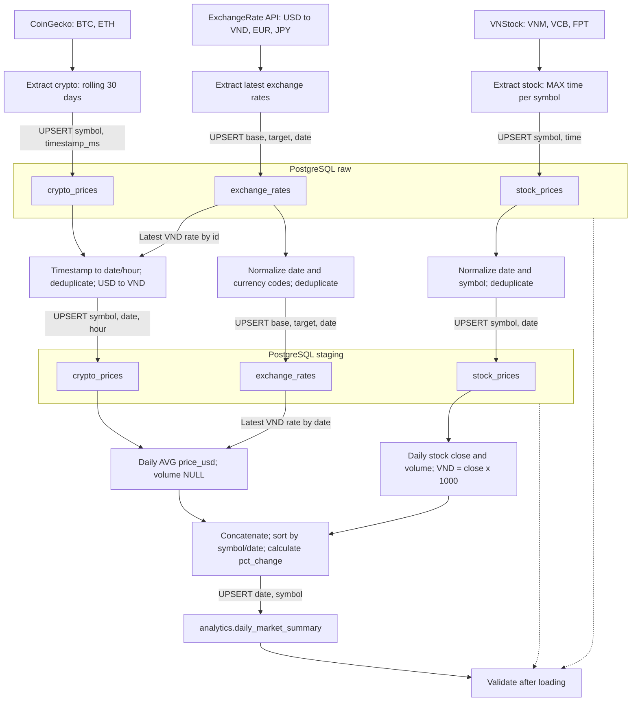

# Data flow

Sơ đồ phản ánh code hiện tại; mũi tên là luồng dữ liệu, không phải foreign key.

## Thứ tự chạy

`main.py`: `run_extract()` → `run_transform()` → `run_load()` → `run_validate()`.

- Extract: stock lấy từ ngày cuối đã có, hoặc 365 ngày khi chưa có dữ liệu. Crypto lấy lại 30 ngày. FX lấy snapshot mới nhất.
- Transform: đọc toàn bộ raw, chuẩn hóa và UPSERT sang staging.
- Load: đọc toàn bộ staging, tính lại daily summary rồi UPSERT sang analytics.
- Validate: yêu cầu 7 bảng không rỗng; kiểm tra một số cột NULL, giá trị và symbol; so khớp business key cổ phiếu raw/staging theo hai chiều.

Các bước ghi theo transaction từng lần UPSERT; toàn bộ pipeline chưa phải một transaction. Validation chạy sau khi ghi nên lỗi validation không tự rollback những dữ liệu đã commit.

## Giới hạn hiện tại cần cải thiện

1. Incremental chỉ áp dụng khi fetch stock; Transform/Load vẫn xử lý toàn bộ dữ liệu.
2. Crypto đang dùng `AVG(price_usd)` làm `close_price`, nên đây là giá trung bình các mẫu theo giờ, chưa phải giá đóng cửa ngày.
3. Quy đổi lịch sử crypto dùng tỷ giá mới nhất, chưa join tỷ giá theo ngày. Transform chọn tỷ giá theo id, Load chọn theo date.
4. Crypto giữ mẫu đầu tiên trong mỗi giờ nhưng chưa sắp xếp timestamp trước deduplicate; chưa có quy ước timezone rõ ràng xuyên suốt pipeline.
5. Validation chưa kiểm tra freshness, đủ symbol, consistency crypto/FX/analytics hoặc toàn bộ tính hợp lệ OHLC.
6. Chưa có timeout/retry HTTP, scheduler, run history hay migration runner.

Các giới hạn trên được ghi lại để tránh mô tả rộng hơn hành vi thực tế khi đưa project vào CV.
