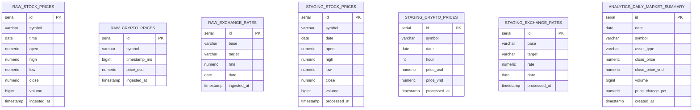

# Data model / ERD

Sơ đồ mô tả cấu trúc trong `sql/create_table.sql`, không phải kết quả introspect database đang chạy. Database cũ có thể khác nếu chưa áp dụng các thay đổi schema.

## Grain và business key

| Bảng | Một dòng đại diện cho | Primary key | UNIQUE constraint |
|---|---|---|---|
| raw.stock_prices | Một cổ phiếu trong một ngày | id | symbol, time |
| raw.crypto_prices | Một quan sát giá crypto tại một timestamp milliseconds | id | symbol, timestamp_ms |
| raw.exchange_rates | Một cặp tiền tệ trong một ngày | id | base, target, date |
| staging.stock_prices | Một cổ phiếu trong một ngày | id | symbol, date |
| staging.crypto_prices | Một crypto trong một giờ của một ngày | id | symbol, date, hour |
| staging.exchange_rates | Một cặp tiền tệ trong một ngày | id | base, target, date |
| analytics.daily_market_summary | Một symbol trong một ngày | id | date, symbol |

Hiện tại chưa có foreign key. Không nối các bảng bằng quan hệ FK giả định: quan hệ biến đổi nằm trong [data flow](data-flow.md). `id` ở mỗi bảng là khóa nội bộ độc lập, không được dùng để join các lớp.

Các UNIQUE constraint là khóa ghép **trên cả bộ cột**, không phải mỗi cột riêng lẻ. Các cột business key hiện chưa có NOT NULL; UNIQUE không thay thế kiểm tra NULL. Khóa analytics hiện giả định tên symbol không trùng giữa các loại tài sản.

## ERD

Tên entity dùng dấu gạch dưới để dễ đọc sơ đồ: ví dụ `RAW_STOCK_PRICES` là `raw.stock_prices`.

## Dùng cùng sơ đồ từ PostgreSQL

Có thể giữ cả Mermaid trong Git và ảnh xuất từ công cụ quản lý PostgreSQL như pgAdmin/DBeaver. Mermaid giúp review thay đổi qua Git; ảnh từ database giúp đối chiếu schema thực tế.

Đọc metadata, sắp xếp vị trí bảng và xuất ảnh không thay đổi dữ liệu. Chỉnh cấu trúc rồi áp dụng SQL/DDL có thể thay đổi database; kiểm tra SQL được tạo trước khi thực thi. Không thêm foreign key chỉ để sơ đồ có đường nối, và không xóa Docker volume để tạo sơ đồ.

Khi xuất ảnh, chọn đủ 7 bảng trong 3 schema, ghi rõ database và ngày xuất. Có thể lưu ảnh tại `docs/images/erd-postgres.png` rồi dẫn link tại đây. Chưa có ảnh xuất từ database trong repo.
